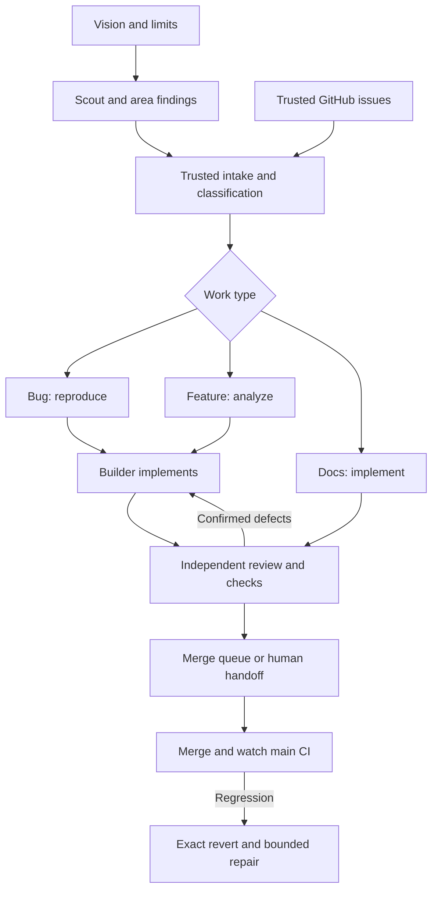

# Engineering methods for Codeden’s dark factory

**Analysis date:** 19 November 2026  
**Codeden:** [`911551159b30ae44367c1cea5f2ba3fa9f755346`](https://github.com/leonvanzyl/codeden/tree/911551159b30ae44367c1cea5f2ba3fa9f755346)  
**EngineeringWorkflows:** [`e8ae675031320195b0ef3a827adfd05b782909f0`](https://github.com/Vidcar/EngineeringWorkflows/tree/e8ae675031320195b0ef3a827adfd05b782909f0), pack version 2.1.0

## The central design decision

Codeden’s dark factory already supplies the engineering process controller. The useful adaptation is a set of **methods for doing each assigned stage well**, with Codeden retaining responsibility for scheduling, ownership, sessions, worktrees, state transitions, review assignment, retries, merging, and recovery.

That conclusion follows from the server implementation. A persisted factory loop advances work items, allocates capacity, starts sessions, evaluates checks, and manages delivery. The global orchestrator and project managers remain useful, but the dark factory is not simply a PM prompt repeatedly delegating the whole lifecycle. Installing EngineeringWorkflows unchanged would introduce competing ownership instructions precisely where Codeden already controls the process. [Factory loop](https://github.com/leonvanzyl/codeden/blob/911551159b30ae44367c1cea5f2ba3fa9f755346/apps/server/src/services/factory/loop.ts#L46-L200); [factory service](https://github.com/leonvanzyl/codeden/blob/911551159b30ae44367c1cea5f2ba3fa9f755346/apps/server/src/services/factory/factory-service.ts#L197-L285)

The seven skills in this pack preserve EngineeringWorkflows’ substantive principles: accountable ownership, bounded assignments, diagnosis before repair, independent expectations, meaningful evidence, proportionate independent review, coherent integration, and honest completion. The original shared contract already says supporting work must not restart the lifecycle. Here, that principle becomes a direct instruction to remain inside the current factory assignment. [EngineeringWorkflows contract](https://github.com/Vidcar/EngineeringWorkflows/blob/e8ae675031320195b0ef3a827adfd05b782909f0/engineering-workflows/references/contract.md#L5-L18)

### What this report establishes

The description below comes from pinned source, schemas, prompts, and documentation in both repositories. Architectural recommendations are identified as judgments. The review consistency and evidence limitations are **findings from inspected code**, not claims that a live exploit was executed.

No live Codeden instance, provider session, factory MCP call, GitHub merge, or project CI run was exercised for this analysis. Separate pack validation and isolated task trials can establish useful properties of the adaptation, but do not establish end-to-end Codeden operation.

## 1. What dark factory changes

Codeden has four autonomy modes. Manual work is user-driven. Assisted mode adds PM triage and automations while the user still merges. Software factory takes GitHub issues through bug, feature, or documentation pipelines. Dark factory adds scheduled discovery: a scout reviews the project against its vision and files work itself. **Automatic merging remains a separate setting, off by default.** Selecting dark factory does not itself authorize automatic merge. [Mode and limits definitions](https://github.com/leonvanzyl/codeden/blob/911551159b30ae44367c1cea5f2ba3fa9f755346/packages/contracts/src/factory.ts#L8-L126)

The other significant difference is unattended decision handling. A dark-factory PM or factory-owned agent does not wait indefinitely for an answer. Questions receive instructions to use the vision, prefer smaller reversible choices, record the decision, and continue. Protected work, missing or contradictory vision, and irreversible actions outside code are flagged with `needsHuman: true`; dependent work is skipped while independent work can continue. Approval requests are denied, never automatically approved. Manually started user sessions in the same project still ask normally. [Unattended behavior](https://github.com/leonvanzyl/codeden/blob/911551159b30ae44367c1cea5f2ba3fa9f755346/apps/server/src/services/factory/unattended.ts#L15-L56)

This matters for skill design. A skill that always asks the user to choose an implementation would interrupt intended autonomy. A skill that treats dark mode as unlimited authority would contradict the implementation. The adapted skills make routine choices within the vision, report material assumptions, and preserve actual permission boundaries.

### Vision and trust are inputs to execution

Starting the factory requires a GitHub project, a vision file, and a daily budget. The default vision path is `.codeden/VISION.md`, with sections for Goals, Target users, Principles, Out of scope, Quality bar, and Protected areas. Its purpose is to supply product direction and constraints; it is not another executable workflow definition. [Start validation](https://github.com/leonvanzyl/codeden/blob/911551159b30ae44367c1cea5f2ba3fa9f755346/apps/server/src/services/factory/factory-service.ts#L345-L387); [vision documentation](https://github.com/leonvanzyl/codeden/blob/911551159b30ae44367c1cea5f2ba3fa9f755346/docs/software-factory.md#L271-L345)

The unattended prompt explicitly places the vision ahead of contradictory current architecture. That makes a clear vision consequential: an aspirational stack change can affect which work the factory prioritizes and which dependent features it defers. The skills therefore distinguish a real vision requirement from a preference inferred by an agent; they do not permit rewriting the vision to make proposed work admissible. [Unattended answer](https://github.com/leonvanzyl/codeden/blob/911551159b30ae44367c1cea5f2ba3fa9f755346/apps/server/src/services/factory/unattended.ts#L26-L33)

Issue trust is explicit. Codeden’s GitHub account and configured author logins are trusted; labels do not grant trust. An untrusted issue admitted by a person can be built, but its PR still requires a person to merge. The factory operates on its own tracked work, not arbitrary PRs. Trust used for comments and learned lessons has related but different rules, so an agent must not infer issue-author admission from comment permissions. [Trust implementation](https://github.com/leonvanzyl/codeden/blob/911551159b30ae44367c1cea5f2ba3fa9f755346/apps/server/src/services/factory/trust.ts)

## 2. Who controls what

The global orchestrator routes across projects. Each project has a PM for project context, triage, questions, and exceptions. Those roles are read-only for project code, with supported changes mediated through tools. The PM can help split oversized work, justify an indivisible large change, or handle appropriate retries. The factory server performs the factory’s lifecycle and merging. [Role architecture](https://github.com/leonvanzyl/codeden/blob/911551159b30ae44367c1cea5f2ba3fa9f755346/docs/orchestration.md#L3-L22); [PM prompt](https://github.com/leonvanzyl/codeden/blob/911551159b30ae44367c1cea5f2ba3fa9f755346/apps/server/src/services/orchestration/prompts.ts#L57-L81)

| Responsibility | Native owner | Contribution of this pack |
| --- | --- | --- |
| Intake, queue, capacity, durable state | Factory server | Report accurate facts; do not create another ledger or scheduler. |
| Product direction and exceptions | Vision, user, PM | Make bounded acceptance, scope, dependency, and risk judgments. |
| Discovery and prioritization | Scout and area sessions | Substantiate findings and avoid speculative or duplicate work. |
| Reproduction, analysis, implementation | Assigned builder | Diagnose, define observable criteria, implement coherently, produce current proof. |
| Independent verdict | Assigned reviewer | Examine requirements, behavior, maintenance, and evidence with an independent lens. |
| Merge, recovery, retries, cleanup | Factory server and designated sessions | Perform only the recovery action actually assigned. |

The server runs periodic passes every 30 seconds and reacts to events with a debounce. Per-project ticks are serialized and repeated requests coalesce. Existing work is settled or advanced before new intake, builds, and scouting. This is why a worker should end at its native reporting boundary instead of polling indefinitely or creating replacement sessions. [Loop implementation](https://github.com/leonvanzyl/codeden/blob/911551159b30ae44367c1cea5f2ba3fa9f755346/apps/server/src/services/factory/loop.ts)

Capacity is shared by builders, reviewers, scouts, and area reviewers. Free slots favor reverts, reviews with green CI, repairs and rebases, reviews while CI is pending, recovered builders, new builds, then discovery. This priority chooses the next claimant; it does not preempt running work. A separate open-PR limit prevents the factory from continually starting work while reviewed changes accumulate. [Slot priorities](https://github.com/leonvanzyl/codeden/blob/911551159b30ae44367c1cea5f2ba3fa9f755346/apps/server/src/services/factory/slots.ts#L5-L36); [work-in-progress tuning](https://github.com/leonvanzyl/codeden/blob/911551159b30ae44367c1cea5f2ba3fa9f755346/packages/contracts/src/factory-api.ts#L339-L388)

Selected defaults at the inspected revision are:

| Setting | Default |
| --- | --- |
| Concurrent factory sessions | 2 |
| Automatic merges per day | 5, only with auto-merge enabled |
| Per-item spend cap | Unset |
| Pause after consecutive relevant failures | 3 |
| Revision attempts | 2 |
| Changed-line limit | 5,000, subject to counting exclusions |
| Required CI | Enabled |
| Scout cadence and backlog threshold | 360 minutes; backlog below 2 |
| Area reviews and new issues per round | Up to 2 areas; up to 3 issues |
| Post-merge main-CI watch | 120 minutes |

These are configurable defaults, not recommended values for every project. [Limits](https://github.com/leonvanzyl/codeden/blob/911551159b30ae44367c1cea5f2ba3fa9f755346/packages/contracts/src/factory.ts#L63-L126); [tuning](https://github.com/leonvanzyl/codeden/blob/911551159b30ae44367c1cea5f2ba3fa9f755346/packages/contracts/src/factory-api.ts#L339-L448)

Factory budgets use the usage ledger. Its cost labels distinguish provider-reported amounts, estimates, and subscription API-equivalent costs; unpriced work is identified. General Usage budgets are alerts, whereas the factory’s budget supplies execution control. Budget configuration is therefore an operator decision, not something a skill should adjust to finish an assignment. [Usage and costs](https://github.com/leonvanzyl/codeden/blob/911551159b30ae44367c1cea5f2ba3fa9f755346/docs/usage-and-costs.md)

## 3. How an item moves through the factory

The lifecycle branches by work type, then converges on evidence, review where required, and delivery:

Pure documentation changes can skip the independent agent review; the checks inspect actual paths before granting that exception. Other branches and failure exits are omitted from the diagram for clarity. [Pipeline implementation](https://github.com/leonvanzyl/codeden/blob/911551159b30ae44367c1cea5f2ba3fa9f755346/apps/server/src/services/factory/pipeline.ts#L14-L231); [docs-only review decision](https://github.com/leonvanzyl/codeden/blob/911551159b30ae44367c1cea5f2ba3fa9f755346/apps/server/src/services/factory/checks.ts#L216-L236)

### Discovery is structured and bounded

The scout chooses from eight areas: features, UX, performance, technical debt, test gaps, security, bugs, and documentation. It uses `factory_plan_round`; Codeden assigns the area reviewers. Each reviewer returns findings through `factory_report_findings`, and the scout consolidates and files selected issues through `factory_file_issue`. One scout and one reviewer per area can retain context across rounds. Memory is useful, but it must be checked against current code. [Scout implementation](https://github.com/leonvanzyl/codeden/blob/911551159b30ae44367c1cea5f2ba3fa9f755346/apps/server/src/services/factory/scout.ts); [scout tools](https://github.com/leonvanzyl/codeden/blob/911551159b30ae44367c1cea5f2ba3fa9f755346/apps/server/src/mcp/tools/factory/scout.ts)

`codeden-scout` improves the judgment within that protocol: identify a real user consequence, establish expected behavior independently, cite the relevant path, check duplicates, and define independently shippable criteria. An empty findings list is valid. Filling a quota with speculative redesign would undermine the bounded discovery system.

### Investigation is a real transition

For a bug, the builder first reproduces it and calls `factory_report_reproduction`. A failing import or missing database is not a reproduction of a behavioral defect. A meaningful failing test or probe should survive into the fix.

For a feature, the builder checks whether the behavior already exists, whether it fits the vision, and what coherent change would deliver it. `factory_submit_analysis` accepts `implement`, `already_done`, `needs_info`, or `out_of_scope`. Implementing requires a spec and 1–12 acceptance criteria. Negative outcomes stop that investigation rather than manufacturing work. The server returns the next-step instruction; merely describing a reproduction or spec in prose does not advance the state. [Builder tools](https://github.com/leonvanzyl/codeden/blob/911551159b30ae44367c1cea5f2ba3fa9f755346/apps/server/src/mcp/tools/factory/builder.ts#L15-L76); [report contracts](https://github.com/leonvanzyl/codeden/blob/911551159b30ae44367c1cea5f2ba3fa9f755346/packages/contracts/src/factory-pipeline.ts#L85-L126)

The same builder normally continues from investigation into implementation. Optional feature-spec approval belongs to software-factory mode; dark factory skips that wait. Nevertheless, the adapted investigator follows the actual response rather than assuming a transition is allowed merely from the project’s usual mode. [Spec approval setting](https://github.com/leonvanzyl/codeden/blob/911551159b30ae44367c1cea5f2ba3fa9f755346/packages/contracts/src/factory-api.ts#L428-L437)

### Implementation ends in a native handoff

The builder commits the change, creates or updates its PR through `create_pull_request`, provides a Test results section, attaches actual test output and required UI screenshots through `attach_evidence`, and calls `finish`. Ordinary revisions update the existing PR. Explicit rebuild and post-revert assignments can require a new branch or PR, so a universal “always reuse this branch” rule would be wrong. [Builder handoff prompt](https://github.com/leonvanzyl/codeden/blob/911551159b30ae44367c1cea5f2ba3fa9f755346/apps/server/src/services/factory/prompts.ts#L93-L130); [recovery](https://github.com/leonvanzyl/codeden/blob/911551159b30ae44367c1cea5f2ba3fa9f755346/apps/server/src/services/factory/recover.ts)

The builder does not select its own reviewer, approve itself, merge, or declare the overall factory finished. Verification and measurement remain supporting methods inside that assignment, using its permissions and result format.

## 4. Review is independent, but evidence still needs judgment

Codeden normally prefers another provider for review where available, with configurable fallback. A fresh session on the builder’s provider can still be independent. Independence of context does not mean filesystem isolation: reviewers often use the builder’s worktree, with explicit offline and no-write instructions. Clean review worktrees are used for particular recovery cases. A skill must not impose its own fetch, reset, checkout, or worktree creation policy. [Reviewer choice](https://github.com/leonvanzyl/codeden/blob/911551159b30ae44367c1cea5f2ba3fa9f755346/apps/server/src/services/factory/reviewer-choice.ts); [review workspace](https://github.com/leonvanzyl/codeden/blob/911551159b30ae44367c1cea5f2ba3fa9f755346/apps/server/src/services/factory/sessions.ts#L260-L307)

The reviewer submits `factory_submit_review`, including the top-level verdict, acceptance criteria, vision alignment, test adequacy, security concerns, and optional follow-ups or lessons. Approval covers the requested head, not a newer commit that arrived during review. New changes can require delta review; equivalent base updates and empty CI kicks have specific approval-preservation logic. [Review contract](https://github.com/leonvanzyl/codeden/blob/911551159b30ae44367c1cea5f2ba3fa9f755346/packages/contracts/src/factory-api.ts#L123-L180); [approval freshness](https://github.com/leonvanzyl/codeden/blob/911551159b30ae44367c1cea5f2ba3fa9f755346/apps/server/src/services/factory/approval.ts#L6-L163)

CI on the PR head is authoritative for the full suite. A reviewer’s broken local installation does not automatically justify a product revision. The native `blockers: "environment"` route distinguishes that case and can trigger reviewer-environment recovery instead of charging the author a revise round. This does not make green CI proof of behavior that the suite never tests; criterion-specific reasoning and focused evidence still matter. [Review prompt](https://github.com/leonvanzyl/codeden/blob/911551159b30ae44367c1cea5f2ba3fa9f755346/apps/server/src/services/factory/prompts.ts#L264-L335); [environment recovery](https://github.com/leonvanzyl/codeden/blob/911551159b30ae44367c1cea5f2ba3fa9f755346/apps/server/src/services/factory/review-environment.ts#L6-L143)

### Presence checks do not establish evidence quality

The server evaluates eight merge checks: protected paths, size, CI, review, tests, test results, security, and UI evidence. Several necessarily depend on agent reports or coarse file/evidence signals. At this revision, a matching Test results Markdown heading can satisfy the test-results check; attached output is another route. UI evidence checks for screenshots when path heuristics identify UI changes. Test adequacy partly depends on the reviewer. Those signals do not independently prove that tests ran on the final content, checked useful behavior, or that a screenshot demonstrates persistence or correct side effects. [Check implementation](https://github.com/leonvanzyl/codeden/blob/911551159b30ae44367c1cea5f2ba3fa9f755346/apps/server/src/services/factory/checks.ts#L92-L347)

This is a particularly valuable place for EngineeringWorkflows principles. `codeden-verify` identifies the claim, independent expected result, actual target, command or interaction, observation, and limit. `codeden-review` asks whether the evidence supports each requirement. Neither treats a green factory badge as sufficient semantic proof.

### A specific criteria and vision consistency gap

The inspected review schema allows `criteria` to default to an empty array. The merge checks use the top-level verdict, test adequacy, and security concerns, but do not separately fail an approval because a criterion says `met: false` or `vision.aligned` is false. The submission handler explicitly rejects approval with security concerns, but does not contain an equivalent consistency rejection for those two fields. [Schema](https://github.com/leonvanzyl/codeden/blob/911551159b30ae44367c1cea5f2ba3fa9f755346/packages/contracts/src/factory-api.ts#L123-L149); [verdict handling](https://github.com/leonvanzyl/codeden/blob/911551159b30ae44367c1cea5f2ba3fa9f755346/apps/server/src/services/factory/decisions.ts#L219-L247); [merge checks](https://github.com/leonvanzyl/codeden/blob/911551159b30ae44367c1cea5f2ba3fa9f755346/apps/server/src/services/factory/checks.ts#L223-L307)

The adapted reviewer explicitly requires all criteria to be accounted for and forbids approval with an unmet criterion or misaligned vision. **That is behavioral mitigation, not a server guarantee.** A separate Codeden hardening change could reject inconsistent approvals and verify criterion coverage against the stored acceptance criteria. Stronger evidence provenance could likewise bind relevant output to head and check identity. Those changes are distinct engineering work; this pack neither implements nor claims them.

## 5. Merging, regression recovery, and stopping

All checks passing means “ready” unless auto-merge is enabled and the item is eligible. Automatic merges are squash merges pinned to the current head. Trusted-author requirements and protected-path handling still apply. The merge queue rechecks state immediately before the action. [Merge implementation](https://github.com/leonvanzyl/codeden/blob/911551159b30ae44367c1cea5f2ba3fa9f755346/apps/server/src/services/factory/merge.ts#L211-L305)

The default fast policy can merge a PR that is behind the default branch using its own green CI. Strict policy updates and tests the new head first. Fast mode falls back when relevant dependency or migration interactions, red main, branch requirements, incomplete information, or unsuitable GitHub state prevent the shortcut. Therefore, it would be inaccurate for a skill to promise that every automatic merge was tested against the fully combined base. [Merge policy](https://github.com/leonvanzyl/codeden/blob/911551159b30ae44367c1cea5f2ba3fa9f755346/packages/contracts/src/factory.ts#L43-L62); [fast-path conditions](https://github.com/leonvanzyl/codeden/blob/911551159b30ae44367c1cea5f2ba3fa9f755346/apps/server/src/services/factory/fast-merge.ts#L8-L171)

After merging, the factory watches main CI. A regression can lead to an exact revert, pause or fast-merge hold, and bounded repair after the revert is green. Exact factory reverts have tailored exceptions: their own CI provides test evidence, and the ordinary screenshot and agent-review requirements do not apply. `codeden-integrate` preserves that distinction instead of imposing the original feature’s entire lifecycle on emergency restoration. [Revert behavior](https://github.com/leonvanzyl/codeden/blob/911551159b30ae44367c1cea5f2ba3fa9f755346/docs/factory-loop.md#L107-L138); [revert evidence checks](https://github.com/leonvanzyl/codeden/blob/911551159b30ae44367c1cea5f2ba3fa9f755346/apps/server/src/services/factory/checks.ts#L263-L320)

Recovery is bounded and classified. Product revisions, rebase conflicts, infrastructure recovery, and oversized changes do not all consume the same counter. Rebase handling allows bounded requests and then a rebuild; recoverable infrastructure failures have their own limit. Pure size failures call for a PM decision, not endless builder revisions. A retry can refresh allowances, so skills must never create private retry loops that evade native limits. [Recovery implementation](https://github.com/leonvanzyl/codeden/blob/911551159b30ae44367c1cea5f2ba3fa9f755346/apps/server/src/services/factory/recover.ts#L25-L144); [retry decisions](https://github.com/leonvanzyl/codeden/blob/911551159b30ae44367c1cea5f2ba3fa9f755346/apps/server/src/services/factory/decisions.ts#L116-L189)

Pause, drain, and stop also differ. Pauses can permit maintenance of in-flight work while preventing new starts. Draining completes selected existing pipelines without new intake or discovery. The kill switch stops factory sessions. On resume, the correct action is to inspect actual state, partial artifacts, and writer ownership, not to restart every step or assume a timed-out writer is gone. [Loop and stop control](https://github.com/leonvanzyl/codeden/blob/911551159b30ae44367c1cea5f2ba3fa9f755346/apps/server/src/services/factory/loop.ts); [EngineeringWorkflows recovery principle](https://github.com/Vidcar/EngineeringWorkflows/blob/e8ae675031320195b0ef3a827adfd05b782909f0/engineering-workflows/references/coordination.md#L37-L47)

## 6. Lessons and follow-ups already have a home

Reviewers can submit up to three short reusable lessons; later briefs receive a bounded set after a delay. They are subordinate notes, not policy or authority. Follow-ups also have a native lifecycle: low/medium findings can be held for scout prioritization, while high-severity or security work can file immediately. Held work is bounded, expires, and is deduplicated. Turning scheduled rounds off does not disable all follow-up filing. [Learning and follow-ups](https://github.com/leonvanzyl/codeden/blob/911551159b30ae44367c1cea5f2ba3fa9f755346/docs/software-factory.md#L44-L61); [dark-factory discovery](https://github.com/leonvanzyl/codeden/blob/911551159b30ae44367c1cea5f2ba3fa9f755346/docs/software-factory.md#L229-L270)

The pack reuses these facilities. It does not require agents to maintain another lessons log, edit their governing skills after every task, or file optional issues through an alternate channel. That preserves the source principle: capture demonstrated reusable knowledge once, preferably in the smallest mechanism that prevents recurrence. [EngineeringWorkflows lessons](https://github.com/Vidcar/EngineeringWorkflows/blob/e8ae675031320195b0ef3a827adfd05b782909f0/engineering-workflows/references/notes.md#L9-L15)

## 7. How the source principles map to the seven skills

| Preserved EngineeringWorkflows principle | Where the adaptation applies it |
| --- | --- |
| One owner; inherited scope, permissions, budget, and endpoint | Every skill retains the current factory assignment; routing guidance leaves process ownership with Codeden. |
| Trace real behavior; separate observation, inference, and hypothesis | Scout substantiates candidates; Investigate establishes reproduction or a bounded spec. |
| Fix causal paths; preserve compatibility and coherent state ownership | Build and Integrate inspect consumers, invariants, failures, and migration effects. |
| Independently derived expectations and meaningful regression checks | Investigate, Verify, and Review require evidence beyond implementation-shaped tests. |
| Proportionate independent scrutiny | Review scales depth to risk without waiving mandatory native stages. |
| Exact artifact and evidence freshness | Build, Review, Verify, and Integrate recheck affected claims after changes. |
| Read-only review and supported dissent | Review reports actionable findings without authoring repairs or substituting votes for evidence. |
| Honest measurement and comparison | Measure records conditions, correctness, variability, and limits; Investigate bounds design alternatives. |
| Stop before replacement; preserve partial work; reconcile uncertain effects | Build and Integrate defer ownership/recovery to Codeden and inspect actual outcomes. |
| Authorized delivery and truthful completion | Native reports, PR evidence, verdicts, and finish remain the only stage endpoints. |
| Small, evidence-based reusable lessons | Review uses native lessons; Scout uses bounded native follow-ups. |

These mappings derive from the [shared contract](https://github.com/Vidcar/EngineeringWorkflows/blob/e8ae675031320195b0ef3a827adfd05b782909f0/engineering-workflows/references/contract.md), [execution methods](https://github.com/Vidcar/EngineeringWorkflows/blob/e8ae675031320195b0ef3a827adfd05b782909f0/engineering-workflows/references/methods.md), [review](https://github.com/Vidcar/EngineeringWorkflows/blob/e8ae675031320195b0ef3a827adfd05b782909f0/engineering-check/SKILL.md), [verification](https://github.com/Vidcar/EngineeringWorkflows/blob/e8ae675031320195b0ef3a827adfd05b782909f0/engineering-verify/SKILL.md), and [measurement](https://github.com/Vidcar/EngineeringWorkflows/blob/e8ae675031320195b0ef3a827adfd05b782909f0/engineering-measure/SKILL.md) sources.

Campaign is omitted because scheduling and recovery belong to Codeden. Configure is omitted because changing skills, model settings, and persistent policy is operator administration. The originals already require direct user intent for those roles. Arena’s useful reasoning survives as bounded comparison; the adaptation does not spawn an inner competition. Independently supplied candidates can be compared honestly, and any synthesis still needs fresh verification. [Campaign](https://github.com/Vidcar/EngineeringWorkflows/blob/e8ae675031320195b0ef3a827adfd05b782909f0/engineering-campaign/SKILL.md); [Configure](https://github.com/Vidcar/EngineeringWorkflows/blob/e8ae675031320195b0ef3a827adfd05b782909f0/engineering-configure/SKILL.md); [Arena](https://github.com/Vidcar/EngineeringWorkflows/blob/e8ae675031320195b0ef3a827adfd05b782909f0/engineering-arena/SKILL.md#L15-L36)

The original MIT notices credit Lauren Tan and Matt Pocock and identify the compilation as independent of its upstream inspirations. The adaptation retains those notices and records source revisions; it does not imply endorsement by Codeden or the original authors. [Source license](https://github.com/Vidcar/EngineeringWorkflows/blob/e8ae675031320195b0ef3a827adfd05b782909f0/engineering-workflows/LICENSE)

## 8. Fit the provider’s native loading model

Codeden exposes native configuration rather than maintaining a separate private skill copy. Codex project skills belong at `.agents/skills/<name>/SKILL.md`; Claude project skills belong at `.claude/skills/<name>/SKILL.md`. Commit complete real directories before factory worktrees are created. A ChatGPT personal skill installation does not place those files into a Codeden project. [Agent configuration](https://github.com/leonvanzyl/codeden/blob/911551159b30ae44367c1cea5f2ba3fa9f755346/docs/agent-config.md#L3-L19); [catalog paths](https://github.com/leonvanzyl/codeden/blob/911551159b30ae44367c1cea5f2ba3fa9f755346/apps/server/src/services/agent-config/catalog.ts#L73-L160)

The pack uses simple one-line name/description metadata and self-contained skill bodies. Codeden’s discovery scans immediate child directories, so per-skill symlinks are unsuitable for reliable inventory. Its simple metadata parser also does not treat multiline YAML descriptions like a full YAML parser. Real provider-specific copies avoid those compatibility problems. [Discovery](https://github.com/leonvanzyl/codeden/blob/911551159b30ae44367c1cea5f2ba3fa9f755346/apps/server/src/services/agent-config/discovery.ts#L94-L117); [metadata parser](https://github.com/leonvanzyl/codeden/blob/911551159b30ae44367c1cea5f2ba3fa9f755346/apps/server/src/services/agent-config/paths.ts#L52-L68)

Short AGENTS.md and CLAUDE.md routing sections select the appropriate method from the current brief. Scout, area reviewer, builder, PR reviewer, and recovery worker all have broad session role `agent`; role alone cannot distinguish them. PM sessions use the project root, while the global orchestrator has a different working directory. The project pack therefore needs no global orchestrator skill. [Factory session creation](https://github.com/leonvanzyl/codeden/blob/911551159b30ae44367c1cea5f2ba3fa9f755346/apps/server/src/services/factory/sessions.ts#L203-L307); [role working directories](https://github.com/leonvanzyl/codeden/blob/911551159b30ae44367c1cea5f2ba3fa9f755346/apps/server/src/services/orchestration/role-sessions.ts#L12-L17)

There is no inspected session-creation field that assigns a skill per factory role or replaces its system prompt. Native provider instructions and skills are the extension surface. The “What’s loaded” view inventories files; it does not prove the provider invoked a full skill body. Verify actual selection in a new session transcript, and ensure the chosen provider has not disabled the skill or restricted it to manual invocation. [Session schema](https://github.com/leonvanzyl/codeden/blob/911551159b30ae44367c1cea5f2ba3fa9f755346/packages/contracts/src/api.ts#L165-L211); [skill controls](https://github.com/leonvanzyl/codeden/blob/911551159b30ae44367c1cea5f2ba3fa9f755346/docs/agent-config.md#L38-L61)

Instruction files and skill directories are not universally protected from automatic merge merely because they govern agents. Codeden excludes such files from the docs-only shortcut, while always protecting its own configuration, vision, and license paths. If policy edits should remain user-controlled, explicitly protect AGENTS.md, CLAUDE.md, and installed skill directories through project settings. This is a deployment recommendation, not an existing blanket protection. [Path policy](https://github.com/leonvanzyl/codeden/blob/911551159b30ae44367c1cea5f2ba3fa9f755346/apps/server/src/services/factory/policy.ts#L90-L229)

## 9. Practical rollout and remaining limits

Start with the seven skills and short routing blocks in one representative project. Keep its vision concrete and its normal check commands reliable. For the first observed run, auto-merge can remain off while dark discovery and the complete build/review pipeline operate. Inspect a scout finding, an investigation report, a PR’s real evidence, and a recorded review verdict. Confirm that a skill was read at the correct stage and that the agent still used Codeden’s native tools.

Then choose merge policy deliberately. Strict mode offers evidence on an updated base; fast mode favors throughput with conditional safeguards and post-merge observation. Neither should be silently changed by the pack. Examine actual revision causes, invalid or environment-only reviews, failed criteria, and post-merge regressions before increasing concurrency or discovery volume. These are proposed rollout judgments, not claimed benchmark results.

The resulting pack has a defined boundary: it improves engineering decisions and evidence inside the factory. It does not enforce tool schemas, close server consistency gaps, guarantee model obedience, establish provider installation correctness, or certify a project’s CI. Its source compatibility is pinned to the revisions above. When Codeden changes its stage contracts or provider-loading behavior, recheck those interfaces and a small representative task set before treating the adaptation as current.

